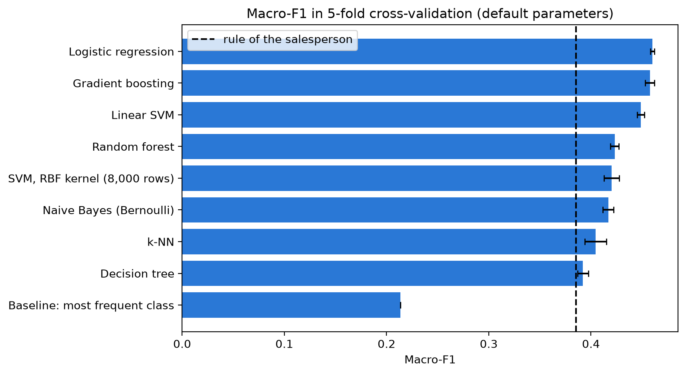
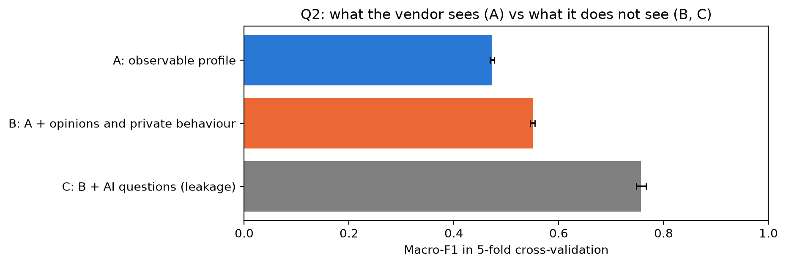
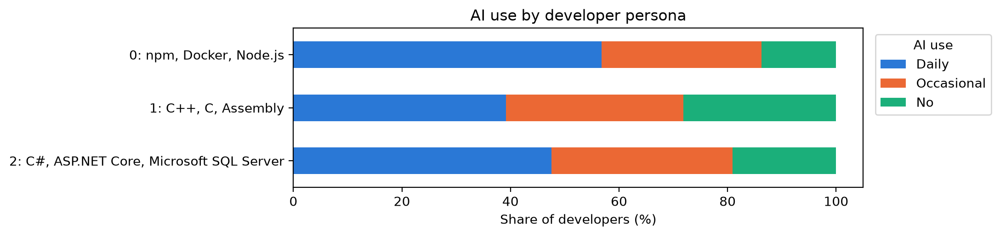
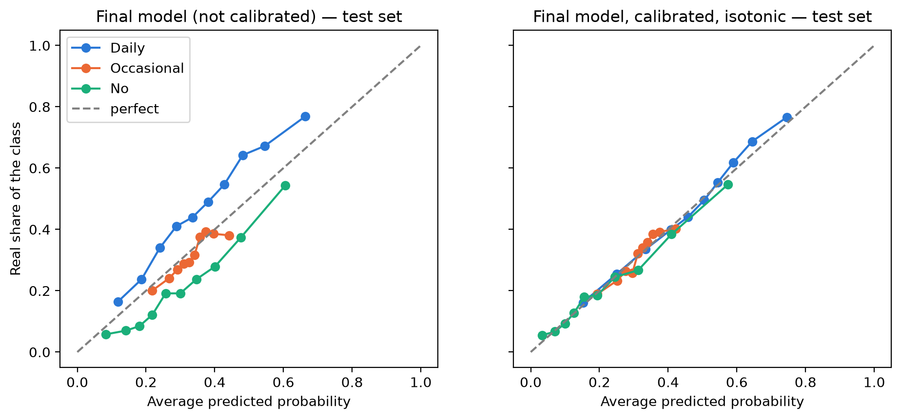

# Who Uses AI at Work? Lead Scoring for an AI Coding-Tool Vendor

A company selling an AI coding assistant has a list of thousands of developers and
can't call them all. Using only what is visible on a **public profile or CV**, we
predict how much each developer uses AI tools (**Daily / Occasional / No**) and turn
the predictions into a **ranked call list** for the sales team.

> Course project for **Hands-on Machine Learning**, M1, Université Paris-Saclay, 2026.

<p>
  
  
  
  
  
</p>

---

## At a glance

| | |
| --- | --- |
| **Business question** | Who should the sales team call first? Occasional AI users are the best leads: they know the tools but have not committed to a competitor yet. |
| **Data** | [Stack Overflow Developer Survey 2025](https://survey.stackoverflow.co/2025/): 33,720 developers with a target, 172 columns. |
| **Approach** | Leakage audit (45 columns removed), 17 observable features → 271 after encoding, scikit-learn pipelines, 8 models compared in 5-fold cross-validation, tuning, soft-voting ensemble, probability calibration, a single final evaluation on a held-out test set. |
| **Main result** | Test macro-F1 **0.467** (95% CI 0.456–0.479), significantly better than a hand-written sales rule (0.383). The model is strongest at spotting **non-users**: in the top 10% it flags, 55% really are non-users, **2.5× better than random**. |
| **Skills** | Data cleaning, leakage detection, feature engineering, `Pipeline` / `ColumnTransformer`, model selection, hyperparameter search, ensembles, calibration, bootstrap confidence intervals, PCA / k-means / t-SNE, translating metrics into business value, ethics (GDPR, fairness). |

---

## The approach, step by step

1. **Leakage audit first.** The survey contains many other questions about AI that
   would give the answer away. We removed 45 such columns, and double-checked the list with a second
   method. This is why our score is honest, and why much higher scores reported
   elsewhere on this dataset are not comparable.
2. **Only what a vendor can see.** Every remaining column was sorted into
   *observable* (role, experience, education, country, company size, industry,
   remote work, technologies used), *not observable* (opinions, private behaviour)
   or *personal data* (age, excluded on purpose).
3. **Baselines before models.** A "most frequent class" baseline and a rule a
   salesperson might write by hand. A model is only worth it if it beats the rule.
4. **Model comparison** in 5-fold cross-validation: logistic regression, linear and
   RBF SVM, k-NN, Naive Bayes, decision tree, random forest, gradient boosting.
5. **Diagnostics**: feature importance (coefficients, impurity, permutation),
   confusion matrix, ablation study, dimensionality reduction, validation and
   learning curves for over/underfitting.
6. **Final model**: tuned logistic regression + gradient boosting + random forest,
   combined by soft voting, then **calibrated** (isotonic) so that the probabilities
   can be read as real chances.
7. **Test set used once**, at the very end, with bootstrap confidence intervals and
   business metrics (precision@k, lift, ROC-AUC).



---

## What we found

**Q1. Is a public profile enough? Partly.** Every model beats the human rule, but the
signal is weak: simple linear models do as well as gradient boosting. The
technologies a developer uses are the most informative part of the profile.

**Q2. How much does the hidden information matter?** A lot. Adding opinions and
private behaviour lifts macro-F1 from 0.47 to 0.55, and the (leaking) AI questions push
it to 0.76.



**Q3. Are there developer personas?** Clustering the technology stacks gives three
overlapping groups: Web/JavaScript developers use AI daily the most, C/C++/systems
developers say "No" the most, .NET developers sit in between.



**Business value.** The model is useful to push probable non-users to the **end** of
the call list (lift 2.5 in the top 10%). Finding Occasional users at the **top** of the
list stays hard (lift 1.2): from a public profile they look like everybody else.

**Calibration.** The raw ensemble over-predicts "No" and under-predicts "Daily".
After isotonic calibration the average gap between predicted and real probabilities
falls from 0.072 to 0.017 on the test set.



**Ethics.** The model uses no age or personal data and only sorts a list: a person
still decides who to call. `Country` is close to nationality, so it should be checked
for unfair treatment before any real use (removing it costs only 0.007 macro-F1).

---

## Repository layout

```
├── ai_usage_lead_scoring.ipynb   the full analysis, with all outputs already shown
├── docs/images/                  the figures used in this README
├── requirements.txt
└── data/                         (created by the notebook, not tracked)
```

The notebook can be read directly on GitHub without running anything.

---

## Run it

```bash
python -m venv .venv && source .venv/bin/activate
pip install -r requirements.txt
jupyter notebook ai_usage_lead_scoring.ipynb
```

The first run downloads the survey (~140 MB) into `data/`. The whole notebook takes
about 30 minutes on a laptop. Tested with scikit-learn 1.6.1.

---

## Authors

- Claudio Bendinelli
- Ludovica De Martino
- Cormac O'Sullivan

The data is published by Stack Overflow under the
[Open Database License (ODbL 1.0)](https://opendatacommons.org/licenses/odbl/1-0/)
and is not redistributed here.
